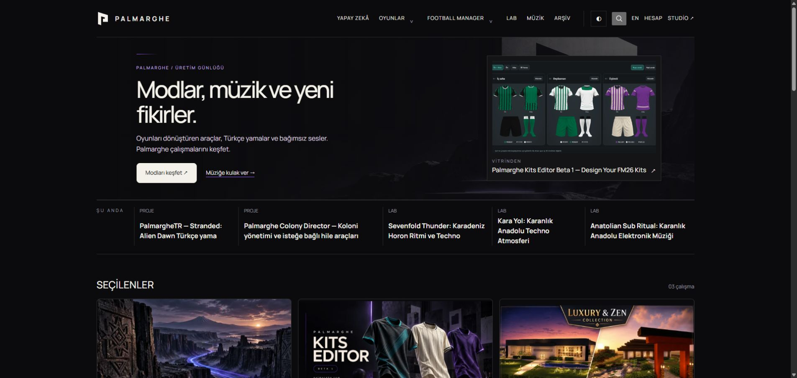

# Showcase selection repair — 14 October 2026

## Confirmed cause
The saved homepage selected the published English record `07667a2e-ce60-4b79-861b-b1fed43cfd31` (Palmarghe Kits Editor Beta 1 — Design Your FM26 Kits) and a separate image. Public Turkish rendering searched only its locale-filtered, 30-record index. It silently fell back to Anatolian Velocity for the title and URL while retaining the chosen image. Native Chrome reproduced this mismatch before deployment.

## Changes
- Resolve an explicit showcase selection by ID when it is absent from the current language/index. The additional read runs only on the homepage.
- Retain publication status/date filters and RLS. Failed reads use the existing service-unavailable response instead of silently displaying another record.
- Link to the selected content's actual locale. Respect its library cover when no separate image is selected.
- Preserve independent custom titles, image overrides and framing controls. Studio help explains which controls change content and which only change artwork.

## Deployment and actual Chrome proof
- Runtime source: `23a8250253b35c74b527d672c981ae9fdca34614`; normal main commit/push and clean committed build on 14 October at 14:49:44 Istanbul.
- Worker: `8e8c16c3-9068-4ed7-a081-0c5625c7873b`.
- Reference-only commit `1e1aadc` and production-test-only commit `850787b` preserve that runtime.
- After reload, actual Chrome displays the chosen kit-editor title and `/en/palmarghe-kits-editor-beta-1/`. Clicking opens that exact URL and the real kit-designer content heading. The saved override image `/api/media/4563d620-a298-42db-88c8-64ae151fe2e8/` is preserved and loaded at 1440px natural width; its endpoint returned 200, image/webp, 59,492 bytes. Captured console warnings/errors were empty.
- Authenticated Studio's selected option and inline preview match the saved English kit-editor record. No production UI save was performed.

## Verification
| Gate | Evidence |
|---|---|
| Local verify | Final 290 checked files, zero errors/warnings/hints; 246/246 unit tests across 47 files and build passed. Ignored review helpers explain the difference from clean CI file counts. |
| Focused reads | 9/9 passed: malformed IDs do not query; explicit lookup retains publication status/date filters and fails safely on service error. |
| Editor/device E2E | 5/5 passed in 20.1s: English selection from the Turkish homepage, both localized homepages retain the selected title/URL, and click opens the detail. Existing independent title/framing/hide/private-preview/recovery checks retained. |
| Visual comparison | All nine changed Studio-homepage references reviewed (three widths × three themes), including a full-size desktop example; only those nine updated. Other 87 references unchanged. Final full comparison 96/96 passed in 1.2m; no new masks or tolerance changes. |
| Production | Initial focused bundle 11/11 passed in 2.3m. Corrected Spotlight test 2/2 passed in 12.1s. Full current production smoke set 33/33 passed in 4.4m. |
| Final source CI | Run `38562169320`, source `850787b`: verify succeeded with 282 clean files, zero diagnostics, 246 units and 150/150 E2E in 11.3m; visual succeeded with 96/96 in 1.5m. Production-smoke succeeded on unchanged failed-job rerun (33/33); all three jobs are green. |

## Failed attempts and their resolution
- Initial regression fixture expected an arbitrary cover_url submitted through an API that accepts library media IDs. Corrected its no-cover expectation to the real fallback; title/URL assertions already passed. No implementation or comparison threshold was relaxed.
- Initial local screenshot comparison had nine expected guidance-text differences. Source CI `38559320816` likewise had 87 passes and nine expected homepage differences. Reviewed and updated those references in `1e1aadc`; final full local and CI visual comparisons passed.
- Combined run `38560021340` passed verify/visual but production finished 32/33 in 4.7m. Its sole failure required the old Colony Director Spotlight. Read-only production settings confirmed `fm_spotlight=false` and a different selected content ID: absence was the correct user configuration. Updated only the test in `850787b` to validate rendered optional Spotlight links and loaded images without requiring an obsolete editorial choice. Existing responsive, axe and category assertions remain. Corrected focused and complete local production tests passed as recorded above.
- A final local verify reported one unused-import hint in an ignored screenshot-review helper. Removed that import; final typecheck returned zero diagnostics.

## Data protection and rollback
No production setting, content, media, account or permission records were deliberately mutated. The user's selected English content, separate image and framing remain unchanged. No migration was needed. To undo the runtime repair, restore the prior Worker; no database rollback is required. Normal commits/pushes preserve Git history; no force push.

The final run's first production attempt finished32/33 in8.8m:archive-density timed out at60s waiting for archive navigation load (ERR_ABORTED when the timed-out page closed), not a showcase assertion. The same unchanged full set had passed33/33 locally4.4m. Requested an unchanged failed-job-only rerun through actual GitHub Chrome; no runtime, test threshold or data changes.

Final source Actions38562169320 attempt2 completed successfully. Only failed production-smoke was rerun unchanged (job115855965069); verify/visual successes were retained. All33production cases passed. No runtime change or test-threshold relaxation was made for the timeout. Actual native GitHub confirmation is saved in showcase-selection-actions-2026-10-14.png. The final documentation-only evidence commit uses [skip ci] to avoid repeating the identical verified source.

Final unchanged GitHub production smoke: 33/33 passed in 6.3m.
